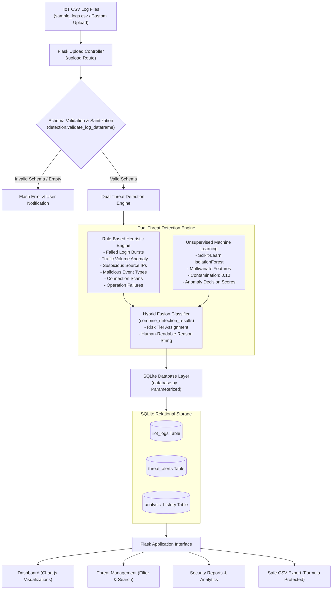

# Threat Detection Framework Based on Industrial Internet of Things (IIoT) Logs

[](https://www.python.org/)
[](https://flask.palletsprojects.com/)
[](https://scikit-learn.org/)
[](https://pytest.org/)
[](LICENSE)

An enterprise-grade, beginner-friendly cybersecurity web application designed to analyze Industrial Internet of Things (IIoT) and SCADA logs. It combines **deterministic cybersecurity rule-based heuristics** with **unsupervised Machine Learning (Isolation Forest)** to detect cyberattacks, brute-force intrusions, operational anomalies, and network traffic spikes.

Suitable for an **MCA / B.Tech Computer Science College Final Project**, cybersecurity research portfolio, and GitHub showcase.

---

## Table of Contents
1. [Project Overview](#1-project-overview)
2. [Problem Statement](#2-problem-statement)
3. [Project Objectives](#3-project-objectives)
4. [Key Features](#4-key-features)
5. [Technologies Used](#5-technologies-used)
6. [System Architecture](#6-system-architecture)
7. [Project Folder Structure](#7-project-folder-structure)
8. [Installation Instructions](#8-installation-instructions)
9. [Windows Execution Instructions](#9-windows-execution-instructions)
10. [Sample Dataset Description](#10-sample-dataset-description)
11. [Threat Detection Methodology](#11-threat-detection-methodology)
12. [Screenshots & UI Walkthrough](#12-screenshots--ui-walkthrough)
13. [Testing Instructions](#13-testing-instructions)
14. [Sample Results & Verification](#14-sample-results--verification)
15. [Limitations](#15-limitations)
16. [Future Enhancements](#16-future-enhancements)
17. [Operational Security Disclaimer](#17-operational-security-disclaimer)
18. [License](#18-license)

---

## 1. Project Overview

Industrial Internet of Things (IIoT) deployments interconnect Programmable Logic Controllers (PLCs), Remote Terminal Units (RTUs), Human-Machine Interfaces (HMIs), and edge gateways across smart factories, power stations, water utilities, and oil refineries. 

Unlike traditional enterprise IT environments, Operational Technology (OT) networks operate continuously under strict real-time constraints. Attacks against IIoT infrastructure can cause physical equipment destruction, environmental damage, and personnel endangerment.

The **IIoT Threat Detection Framework** is a complete Python Flask application that ingests industrial telemetry and access logs, performs validation, cross-references logs against deterministic cyber rules, applies Scikit-learn's Isolation Forest algorithm for multivariate anomaly detection, stores records in a lightweight SQLite database, and presents actionable intelligence through a dark navy cybersecurity dashboard.

---

## 2. Problem Statement

Industrial controllers historically operated in air-gapped physical silos with proprietary communication protocols (such as Modbus, DNP3, and EtherNet/IP) designed without native encryption or authentication. As Industry 4.0 integrates OT devices directly with cloud networks and edge gateways, industrial environments face severe attack vectors:

- **Brute-force authentication and credential stuffing** on unprotected HMI management consoles.
- **Volumetric Distributed Denial of Service (DDoS)** packet floods incapacitating fragile PLC network interfaces.
- **Unauthorized Modbus/PLC command injection** altering actuator setpoints and boiler thresholds.
- **Rogue firmware modification attempts** and buffer overflow payloads executed against embedded sensors.
- **Data exfiltration** siphoning operational telemetry to hostile external networks.

Traditional signature-only firewalls miss novel zero-day behavioral anomalies, while purely black-box machine learning systems produce false alarms without human-interpretable justifications. This project addresses both challenges by pairing deterministic heuristics with multivariate unsupervised anomaly detection.

---

## 3. Project Objectives

1. **Dual-Layer Threat Detection**: Integrate 6 deterministic industrial cybersecurity rules with Scikit-learn's Isolation Forest anomaly detector.
2. **Interactive Security Dashboard**: Provide high-level visibility into total logs, normal baselines, suspicious events, and high/critical risk alerts with interactive Chart.js visualizations.
3. **Robust CSV Ingestion & Validation**: Enforce schema structure, sanitize numeric values, safely reject malformed files, and handle empty datasets gracefully.
4. **Transparent Alert Reasoning**: Generate clear, human-readable explanations detailing exactly why an event was flagged (rule triggers, ML anomaly scores).
5. **Secure Local Persistence**: Store logs and threat history using parameterized SQLite queries to eliminate SQL injection vulnerabilities.
6. **Defensive Data Export**: Support exporting flagged threat alerts to CSV with spreadsheet formula injection protection.

---

## 4. Key Features

- **Dark Navy Cybersecurity UI**: High-contrast, responsive visual interface tailored for Security Operations Center (SOC) analysts.
- **Multi-Level Threat Classification**: Categorizes alerts into four standardized risk tiers: `Low`, `Medium`, `High`, and `Critical`.
- **Hybrid Fusion Engine**: Cross-validates statistical outliers with known threat rules to minimize false positives and prevent duplicate alerts.
- **Threat Management Workspace**: Dedicated view with real-time risk filtering (`All`, `Critical`, `High`, `Medium`, `Low`) and search by Device ID or Source IP.
- **Security Assessment Reports**: Visualizes top 5 targeted industrial devices, top 5 hostile source IPs, and attack vector breakdowns.
- **One-Click Demo Mode (`/load-sample`)**: Pre-loads bundled synthetic industrial logs (`sample_logs.csv`) with 130 records for evaluation.
- **Hardened Security**: Strict 16 MB upload limits, safe filename sanitization, parameterized queries, and CSV formula sanitization (`=`, `+`, `-`, `@`).

---

## 5. Technologies Used

| Layer | Technology | Purpose |
|---|---|---|
| **Backend Language** | Python 3 (3.10+) | Application logic, detection algorithms, data transformation |
| **Web Framework** | Flask 3.x | Routing, template rendering, HTTP request/response pipeline |
| **Database** | SQLite 3 (WAL mode) | Parameterized relational storage for logs and security alerts |
| **Data Processing** | Pandas 2.x / 3.x | CSV ingestion, schema validation, type sanitization |
| **Machine Learning** | Scikit-Learn 1.x | Isolation Forest unsupervised anomaly detection |
| **Numerical Library** | NumPy 2.x | Continuous anomaly scoring and array transformations |
| **Testing** | Pytest 9.x | 27 automated unit and integration tests |
| **Frontend Styling** | HTML5, Modern CSS3 | Responsive dark navy theme, glassmorphic cards, badges |
| **Visualizations** | Chart.js 4.4 | Doughnut and bar charts for severity and risk distribution |

---

## 6. System Architecture

The following diagram illustrates the end-to-end data flow from CSV ingestion to machine learning analysis, SQLite persistence, and UI rendering:



---

## 7. Project Folder Structure

```text
iiot-threat-detection-framework/
│
├── app.py                     # Main Flask web application, route handlers, error handlers
├── detection.py               # Threat detection engine: input validation, rules, Isolation Forest
├── database.py                # SQLite database management, parameterized queries, schema init
├── requirements.txt           # Verified Python runtime dependencies
├── sample_logs.csv            # 130 rows of synthetic IIoT industrial telemetry and attack logs
├── README.md                  # Comprehensive project documentation
├── LICENSE                    # MIT open-source license
├── .gitignore                 # Excludes virtual environments, SQLite DBs, bytecode, caches
├── .env.example               # Safe environment variable template
│
├── templates/                 # Jinja2 HTML5 frontend templates
│   ├── base.html              # Main layout: sidebar navigation, header, security disclaimer
│   ├── index.html             # Dashboard: metric cards, Chart.js canvases, recent threats
│   ├── upload.html            # Drag-and-drop CSV upload, schema guidelines, sample loader
│   ├── logs.html              # Complete telemetry table with risk filtering and search
│   ├── threats.html           # Threat management table with engine flags (Rule vs ML)
│   └── reports.html           # Executive report summary, top 5 devices, top 5 hostile IPs
│
├── static/                    # Frontend styling and scripts
│   ├── style.css              # Dark navy cybersecurity CSS stylesheet
│   └── dashboard.js           # Chart.js initialization, dark theme options, mobile menu
│
└── tests/                     # Automated unit and integration test suite
    ├── test_detection.py      # Unit tests for detection logic, rules, Isolation Forest, edge cases
    └── test_app.py            # Integration tests for Flask routes, upload validation, CSV export
```

---

## 8. Installation Instructions

### Prerequisites
- **Python 3.10** or higher installed on your machine.
- `pip` package manager.
- Git (optional, for cloning repository).

### Step 1: Clone or Extract the Project
```bash
git clone https://github.com/your-username/iiot-threat-detection-framework.git
cd iiot-threat-detection-framework
```

---

## 9. Windows Execution Instructions

Open **PowerShell** or **Command Prompt** inside the project root folder:

### Step 1: Create a Virtual Environment
```powershell
python -m venv venv
```

### Step 2: Activate the Virtual Environment
On **PowerShell**:
```powershell
.\venv\Scripts\Activate.ps1
```
*(Note: If you receive a PowerShell script execution policy error, run: `Set-ExecutionPolicy -ExecutionPolicy RemoteSigned -Scope Process` and retry activation).*

On **Command Prompt (CMD)**:
```cmd
venv\Scripts\activate.bat
```

### Step 3: Install Required Dependencies
```powershell
pip install -r requirements.txt
```

### Step 4: Run the Flask Web Application
```powershell
python app.py
```

You will see output confirming initialization:
```text
=================================================================
 IIoT Threat Detection Framework - Web Application Started
 URL: http://127.0.0.1:5000
 Machine Learning Engine: Scikit-learn Isolation Forest
 Database: SQLite Parameterized Store
=================================================================
```

### Step 5: Open in Your Web Browser
Open your browser and navigate to:
```text
http://127.0.0.1:5000
```

### Step 6: Run Automated Tests
Open a second terminal window (with the virtual environment activated) and run:
```powershell
python -m pytest -v
```

### Troubleshooting Common Windows Issues
- **`python: command not found`**: Ensure Python was added to your Windows system PATH during installation.
- **Port 5000 already in use**: Start the app on a different port using environment variables:
  ```powershell
  $env:FLASK_RUN_PORT="5050"
  python app.py
  ```
- **PermissionError on database**: Ensure no other application (such as an external SQLite viewer) has locked `iiot_security.db`.

---

## 10. Sample Dataset Description

The bundled `sample_logs.csv` dataset contains **130 records** spanning normal operations, edge gateway telemetry, sensor polling, and diverse industrial cyber threat scenarios.

### Expected Schema

| Column Name | Data Type | Description | Example Values |
|---|---|---|---|
| `timestamp` | String / DateTime | ISO or standard date-time string | `2026-03-10 08:26:05` |
| `device_id` | String | Industrial controller or endpoint tag | `PLC-MODBUS-01`, `GATEWAY-EDGE-01`, `HMI-PANEL-02` |
| `source_ip` | String (IPv4) | Request originating IP address | `192.168.10.15`, `198.51.100.45` |
| `event_type` | String | Telemetry or network event identifier | `telemetry_read`, `ddos_packet_flood`, `port_scan` |
| `failed_logins` | Integer | Consecutive failed authentication count | `0`, `3`, `5`, `8`, `14` |
| `network_traffic` | Float | Payload size transmitted in Kilobytes (KB) | `45.2`, `890.4`, `92150.0` |
| `status` | String | Outcome status of operation | `success`, `normal`, `failed`, `timeout`, `error` |

### Threat Scenarios Included in Sample Data
- **Normal Industrial Baselines**: Continuous telemetry from turbines, flow meters, boiler temperature sensors, and pump controllers (traffic 15–450 KB, 0 failed logins, status `success` / `normal`).
- **Brute-Force & Credential Stuffing**: Progressive failed login bursts against HMI consoles (`failed_logins` climbing from 3 to 14 from external simulator IPs).
- **Volumetric DDoS Flooding**: Extreme network packet floods targeting edge gateways (`GATEWAY-EDGE-01` experiencing 68,000 KB to 115,400 KB traffic spikes).
- **Network Reconnaissance & Port Scanning**: Rapid connection probes from untrusted subnets (`port_scan` ending in `timeout` and `rejected`).
- **Critical Industrial Exploits**: Malicious command payloads including `unauthorized_firmware_update`, `buffer_overflow_attempt`, and `unauthorized_modbus_write`.
- **Operational Failures**: Sensitive valve actuations and pump adjustments returning `error` or `timeout`.

---

## 11. Threat Detection Methodology

```text
Log Record ──> [Schema Validator]
                      │
           ┌──────────┴──────────┐
           ▼                     ▼
 [Rule-Based Engine]     [Isolation Forest ML]
 (6 Cyber Heuristics)    (Multivariate Outliers)
           │                     │
           └──────────┬──────────┘
                      ▼
          [Hybrid Fusion Classifier]
                      │
           Assigns: Low / Medium / High / Critical
           Generates: Human-Readable Detection Reason
```

### A. Deterministic Rule-Based Heuristics
1. **Repeated Failed Logins**:
   - $\ge 8$ attempts $\rightarrow$ **Critical** (Severe Brute-Force / Password Spraying)
   - $5 - 7$ attempts $\rightarrow$ **High** (Credential Stuffing Attack)
   - $3 - 4$ attempts $\rightarrow$ **Medium** (Elevated Authentication Threshold)
   - $1 - 2$ attempts with `failed`/`rejected` status $\rightarrow$ **Low** (Policy Warning)
2. **Abnormal Network Traffic Spikes**:
   - $\ge 20,000\text{ KB}$ $\rightarrow$ **Critical** (Volumetric DDoS / Massive Exfiltration)
   - $5,000 - 19,999\text{ KB}$ $\rightarrow$ **High** (High-Bandwidth Anomalous Burst)
   - $1,500 - 4,999\text{ KB}$ $\rightarrow$ **Medium** (Elevated Bandwidth Transfer)
3. **Suspicious Source IP Addresses**:
   - Matches hostile ranges or RFC 5737 testnets (`198.51.100.*`, `203.0.113.*`, `185.220.101.*`, `45.33.32.*`) accessing internal industrial controllers.
4. **Malicious Industrial Exploits**:
   - Triggers for dangerous event types: `unauthorized_firmware_update`, `buffer_overflow_attempt`, `ddos_packet_flood`, `command_injection`, `unauthorized_modbus_write`.
5. **Reconnaissance & Connection Probing**:
   - Triggers on `port_scan`, `ssh_bruteforce`, `connection_hijack`, and `dos_flood`.
6. **Failed Critical Operations**:
   - Flags when sensitive operations (`valve_actuation`, `actuator_command`, `firmware_verify`) terminate in `failed`, `error`, or `timeout`.

### B. Unsupervised Machine Learning (Isolation Forest)
- **Model**: Scikit-Learn `IsolationForest(n_estimators=100, contamination=0.1, random_state=42)`.
- **Feature Space**: Quantitative dimensions (`network_traffic`, `failed_logins`).
- **Safety Safeguards**: Automatically skips execution if dataset has fewer than 10 samples or exhibits zero variance, preventing runtime mathematical crashes.
- **Continuous Scoring**: Calculates `decision_function()` anomaly scores to measure how deeply isolated an observation is from the baseline cluster.

### C. Hybrid Fusion Classifier
The engine fuses the rule severity score with the Isolation Forest prediction:
- If Rule indicates **Critical** $\rightarrow$ **Critical**
- If Rule indicates **High** and verified by ML Anomaly $\rightarrow$ **Critical** (Escalated)
- If Rule indicates **High** alone $\rightarrow$ **High**
- If Rule indicates **Medium** and verified by ML Anomaly $\rightarrow$ **High**
- If ML Anomaly fires without matching a specific rule $\rightarrow$ **Medium** (Unclassified Outlier)
- If all parameters within expected baseline $\rightarrow$ **Normal**

---

## 12. Screenshots & UI Walkthrough

### 1. Operations Dashboard (`/`)
Displays 5 summary cards (**Total Logs**, **Normal Operations**, **Suspicious Events**, **High-Risk Alerts**, **Critical Alerts**), two interactive Chart.js visualizations (Threat Severity Breakdown and Security Health Ratio), and the latest flagged events table.

```text
+-----------------------------------------------------------------------------------+
|  IIoT Sentinel  [ Engine: Active | ML: Isolation Forest | Storage: SQLite WAL ]   |
+-----------------------------------------------------------------------------------+
|  [Total: 130]   [Normal: 111]   [Suspicious: 19]   [High: 1]   [Critical: 16]     |
|                                                                                   |
|  [ Chart: Threat Risk Distribution ]        [ Chart: Normal vs Flagged Ratio ]    |
|  - Critical: 16 (Red)                       - Normal Baseline: 85.4% (Green)      |
|  - High: 1     (Orange)                    - Suspicious:      14.6% (Yellow)     |
|  - Medium: 2   (Yellow)                                                           |
|                                                                                   |
|  Recent Suspicious Activities Table                                               |
|  Timestamp           Device ID         Event Type        Traffic       Risk Level |
|  2026-03-10 08:55    GATEWAY-EDGE-01   ddos_packet_flood 115,400 KB    CRITICAL   |
|  2026-03-10 09:22    HMI-PANEL-02      ssh_bruteforce    560 KB        CRITICAL   |
+-----------------------------------------------------------------------------------+
```

### 2. CSV Upload & Schema Specification (`/upload`)
Offers a drag-and-drop upload zone, maximum size indicators (16 MB), column specification documentation, and a **Load Sample IIoT Dataset** button for instant evaluation.

### 3. Telemetry & Security Logs (`/logs`)
Full paginated table of all ingested industrial logs with inline status badges, traffic measurements, and risk filter dropdowns.

### 4. Threat Management & Triage (`/threats`)
Detailed table displaying all flagged security alerts, highlighting dual-engine detection badges (`Rule` vs `ML`), filtered by risk tier (`Critical`, `High`, `Medium`, `Low`), and searchable by Device ID or Source IP.

### 5. Security Reports & Analytics (`/reports`)
Executive security summary with printable view (`window.print()`), Top 5 Targeted Industrial Devices ranking, Top 5 Hostile Source IPs, and a direct link to download the sanitized CSV report.

---

## 13. Testing Instructions

The framework includes **27 automated tests** written with Pytest. Tests run without needing the Flask web server to be actively running.

### Executing the Test Suite
```bash
python -m pytest -v
```

### Test Coverage Summary
- **Input Validation**: Tests rejection of missing columns, empty files, and safe type coercion of malformed numeric fields (`test_detection.py`).
- **Rule Verification**: Tests brute-force thresholds (3, 5, 8+ logins), bandwidth volume spikes (1,500 KB, 7,500 KB, 50,000 KB), untrusted IPs, malicious exploit events, and failed critical operations.
- **Machine Learning**: Tests Isolation Forest behavior on valid datasets, handling datasets with $< 10$ records, and zero variance datasets.
- **Flask Integration**: Tests all web routes (`/`, `/upload`, `/load-sample`, `/logs`, `/threats`, `/reports`, `/export`, `/api/stats`), file upload validation, and spreadsheet formula injection sanitization.

---

## 14. Sample Results & Verification

When running the engine against `sample_logs.csv`, the following verifiable results are produced:

```text
=============================================================
             IIoT THREAT DETECTION ANALYSIS REPORT
=============================================================
Total Industrial Logs Analyzed : 130
Normal Operating Baseline Logs : 111 (85.38%)
Flagged Threat Incidents       : 19  (14.62%)

Severity Breakdown:
  - Critical Severity Alerts   : 16
  - High Risk Alerts           : 1
  - Medium Risk Alerts         : 2
  - Low Risk Alerts            : 0

Top Targeted Industrial Endpoints:
  1. GATEWAY-EDGE-01           : 5 alerts (DDoS Floods & Port Scans)
  2. HMI-PANEL-02              : 7 alerts (SSH & Web Brute-Force Attacks)
  3. SCADA-RTU-04              : 2 alerts (Data Exfiltration & Modbus Write)
  4. PLC-MODBUS-01             : 1 alert  (Buffer Overflow Attempt)
  5. PLC-MODBUS-02             : 2 alerts (Firmware Tamper & Command Injection)

Top Flagged Source IPs:
  1. 198.51.100.77             : 3 alerts (Volumetric DDoS Flood)
  2. 198.51.100.45             : 4 alerts (Brute-Force Login Bursts)
  3. 45.33.32.156              : 3 alerts (SSH Brute-Force)
  4. 203.0.113.19              : 2 alerts (Port Scanning)
=============================================================
```

---

## 15. Limitations

1. **Batch Analysis vs Real-Time Streaming**: Currently processes uploaded CSV batches rather than listening to live sub-millisecond industrial message brokers (e.g. MQTT, Kafka, OPC-UA).
2. **Simplified Feature Space**: Uses network traffic volume and failed login counts for machine learning; does not parse deep industrial packet payloads (e.g. raw Modbus function codes, register address hex values).
3. **Unsupervised Contamination Prior**: Uses a predefined contamination rate (0.10) for Isolation Forest, which may require tuning across different plant environments.

---

## 16. Future Enhancements

- **Real-Time OPC-UA & MQTT Connectors**: Ingest telemetry directly from physical PLCs and edge brokers.
- **MITRE ATT&CK for ICS Mapping**: Automatically map detected threat events to official MITRE ATT&CK for Industrial Control Systems (ICS) technique IDs (e.g. T0814, T0855).
- **Deep Learning Autoencoders**: Incorporate PyTorch or TensorFlow LSTM autoencoders for temporal time-series anomaly detection.
- **Automated Defensive Response**: Export dynamic IPTables / firewall drop rules to isolate compromised device IPs automatically.

---

## 17. Operational Security Disclaimer

> **ADVISORY NOTICE**: The anomaly detection algorithms and heuristic rules in this application identify statistically anomalous patterns, suspicious deviations, and security policy violations. **Flagged alerts do not constitute definitive proof of an active cyberattack or security breach.** All alerts must undergo formal verification, telemetry correlation, and triage by qualified cybersecurity analysts and OT plant operators before executing defensive remediation actions.

---

## 18. License

This project is open-source and distributed under the [MIT License](LICENSE). Feel free to adapt, customize, and extend it for academic research, coursework, and portfolio showcases.

